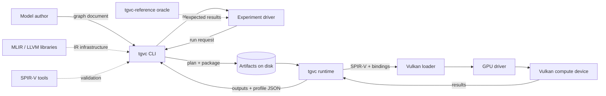
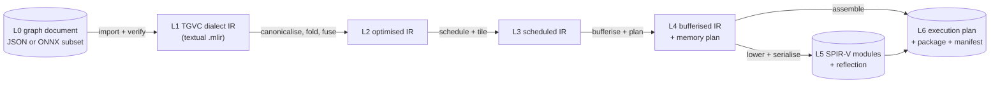
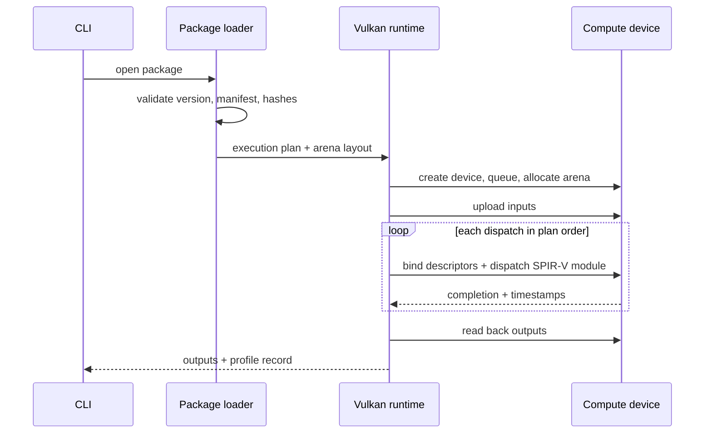

# TGVC Architecture

Tensor Graph to Vulkan Compiler — architecture document, version 0.

This document describes the structure of the compiler and runtime: which parts exist, what each part owns, what crosses each boundary, which promises hold, and how each part fails. It is the authoritative statement of *how the system is put together*; it does not restate the research framing, the capability matrix or the work breakdown.

## 1. Status and enforcement

| Field | Value |
|---|---|
| Version | 0 (initial) |
| Frozen by | TF-003, architecture review |
| Authority | This document is authoritative for component boundaries and interfaces |
| Reviewer | The project owner, at each milestone boundary |
| Reviewed against | The seven fields in Section 7, the frozen capability matrix, and the code as it stands |

This document is not covered by a test suite, and that is a deliberate boundary rather than an omission. Tests guard programs and schemas. Whether a design document is still true is a judgement about intent, and no assertion over headings and labels can make that judgement — it can only make the document harder to edit without making it more correct. The seven fields in Section 7 are therefore the review checklist, applied by reading the document against the code rather than by a build step.

## 2. Purpose and relationships

| Document | Question it answers | Relationship |
|---|---|---|
| [PROPOSAL.md](PROPOSAL.md) | What is being researched and how success is measured | This document exists to make the proposal buildable |
| [SCOPE.md](SCOPE.md) | Exactly which graphs are accepted, and how everything else is rejected | Authoritative for capability; this document never restates the matrix |
| `tgvc_backlog.json` | Which work delivers which part | Epics are mapped to components in Section 17 |
| This document | How the system is decomposed, and what each boundary promises | Authoritative for structure and interfaces |

Three rules follow from those relationships. First, a capability question is answered only by SCOPE.md; if the architecture needs something outside the frozen matrix, the matrix changes first, with its own tests. Second, a work question is answered only by the backlog; this document says where a change belongs, not when it is scheduled. Third, a research question is answered only by PROPOSAL.md; the evaluation design here implements it rather than extending it.

## 3. Goals and quality attributes

| Attribute | What it means here | Enforced by |
|---|---|---|
| Correctness before speed | Every generated result is checked against an independent oracle before any timing is reported | Reference interpreter, conformance suite (TF-E05, TF-E13) |
| Reproducibility | The same graph and options produce byte-identical artifacts and the same measurement scenario | Deterministic passes, sorted scheduling, hashed artifacts (TF-E02, TF-E12) |
| Explainability | Every scheduling and memory decision has a recorded reason | Decision traces, diagnostics with locations (TF-E08, TF-E12) |
| Inspectability | A failure can be localised from the message alone | Diagnostic taxonomy, MLIR round-tripping, remarks (TF-E12) |
| Portability | Public, device-independent target profiles; no proprietary formats or blobs | Target model schema, clean-room constraints (TF-E04, TF-E08) |
| Bounded scope | The system rejects what it cannot handle instead of guessing | Scope matrix and frontend verification (TF-E02, TF-E03) |

Speed is an outcome measured later, never a reason to skip verification. A fast wrong answer is a defect, not a result.

## 4. Core scope and non-goals

The capability boundary lives in [SCOPE.md](SCOPE.md) and `schemas/tgvc-operators-v1.json`; this section records only what the architecture assumes about it.

| Operator | Why it is in the first release |
|---|---|
| `Constant` | Supplies weights and biases without a second input format |
| `Add` | The smallest complete vertical slice: one dispatch, one buffer, one result |
| `Mul` | Elementwise arithmetic and scaling |
| `ReLU` | The canonical activation, and the simplest fusion partner |
| `MatMul` | The dense compute primitive and the main optimisation target |
| `Reshape` | Shape plumbing that must survive compilation without data movement |
| `Transpose` | The remaining layout operation needed by real graphs |

Assumptions the architecture depends on:

- Element type is `float32` only. No quantised or mixed-precision paths exist in version 0.
- Tensors are static, ranked, and dense, with rank between one and four.
- Execution targets Vulkan compute through SPIR-V; there is no CPU fallback path and no graphics pipeline.
- Elementwise operators require identical operand shapes; there is no broadcasting.
- Non-goals (full ONNX, dynamic shapes, control flow, training, driver integration, proprietary details) are unchanged from SCOPE.md and are not revisited here.

Anything outside those assumptions is rejected at the frontend boundary, with a category from the rejection taxonomy, before any lowering happens.

## 5. System context

<!-- diagram:context -->


The system compiles one graph at a time, offline, and produces a self-contained artifact set that can be executed later on a machine with a Vulkan driver. Nothing in the compile path touches the device; nothing in the runtime path reads the source graph. That separation is what makes compiled artifacts inspectable and measurements repeatable.

## 6. Containers

<!-- diagram:container -->
```mermaid
flowchart TB
    graph[("Graph document<br/>JSON or ONNX subset")] --> fe["Frontend"]
    fe --> dialect["TGVC dialect"]
    dialect --> passes["Optimization pipeline"]
    passes --> scheduler["Target model and scheduler"]
    scheduler --> bufferize["Bufferization and memory planning"]
    bufferize --> codegen["SPIR-V code generation"]
    codegen --> plan["Execution plan and package"]
    plan --> artifact[("Execution plan<br/>SPIR-V + manifest")]
    artifact --> runtime["Vulkan runtime"]
    runtime --> device[["Vulkan compute device"]]
    profile[("Target profile")] --> scheduler
    profile --> runtime
    cli["tgvc CLI"] --> fe
    cli --> runtime
    reference["Reference interpreter"] --> harness["Test harness"]
    harness --> cli
```

| Container | Lifetime | Depends on |
|---|---|---|
| Compiler library | Build and compile time | MLIR, SPIR-V tooling, its own dialect |
| Runtime library | Run time | Vulkan loader and driver, the execution plan |
| CLI | Invocation | Both libraries; owns no semantics |
| Reference interpreter | Test time | Nothing but the standard library and the graph |
| Test harness | Build and test time | Reference interpreter, CLI, runtime |
| Artifacts | Between compile and run | Nothing; they are the interface |

The compile and run containers share no mutable state. Their only contract is the artifact set, which is why the artifact format is treated as an interface with an owner rather than as an implementation detail.

## 7. Components

Each component below is a unit of ownership: it has one reason to change, one boundary to defend, and one set of promises. Every component answers the same seven questions, and a component that cannot answer one of them is not designed yet.

### 7.1 Frontend

**Responsibility:** Accept a graph document, validate it against the frozen capability table, and build a canonical, located TGVC dialect module. Two frontends exist: the canonical JSON format (owned here) and the restricted ONNX subset (TF-E05). The frontend normalises names, resolves constants, canonicalises attribute spelling, and attaches source locations to every operation it creates.

**Inputs:** A graph document (JSON or ONNX file), the operator capability table, and frontend options that only choose defaults (output name, strictness).

**Outputs:** A verified high-level module in the TGVC dialect, plus a diagnostic stream. On rejection, no partial module escapes.

**Interface:** `Frontend::import(source, options) -> module | diagnostics`, with diagnostics carrying a category, a source location and a human message. The frontend never emits SPIR-V and never talks to a device.

**Invariants:** Only operators, element types, ranks and shapes permitted by the frozen matrix are admitted; shapes are literal and positive; every operation carries a location; identical input bytes produce identical modules.

**Failure behaviour:** Rejection happens before any lowering, with one category from the taxonomy (`unsupported_operator`, `unsupported_dtype`, `unsupported_rank`, `dynamic_dimension`, `unsupported_attribute`, `malformed_graph`). The CLI maps the category to a stable exit code; nothing downstream sees a half-imported module.

**Epics:** TF-E03, TF-E05.

### 7.2 TGVC dialect

**Responsibility:** Define the tensor-level semantics and the static shape discipline that the rest of the compiler relies on. The dialect is the single place where operation meaning, type rules and verification live, so optimisation and lowering can assume well-typed input.

**Inputs:** Operations and types constructed by the frontend, or parsed from textual MLIR during debugging.

**Outputs:** A verified high-level IR that round-trips through text without semantic change.

**Interface:** ODS operation definitions, a static ranked tensor type restricted to `float32`, and verifiers that run on construction, on parse, and after each rewrite. No operation is added without a verifier.

**Invariants:** Operand and result types agree; elementwise operands have identical shapes; `Reshape` produces a compatible element count and honours the single `-1` sentinel; `MatMul` inner dimensions agree; verification depends only on the operation, never on device state.

**Failure behaviour:** Verification failures are reported as diagnostics with the offending operation and location. An unregistered operation or an attribute outside the schema is rejected, never silently ignored.

**Epics:** TF-E03.

### 7.3 Optimization pipeline

**Responsibility:** Improve the graph without changing its results. The pipeline performs canonicalisation, constant folding, dead-code elimination, common subexpression elimination, and the fusion of elementwise chains and `MatMul`-bias-activation patterns into single kernels.

**Inputs:** A verified high-level module and an optimisation level (none, default, aggressive).

**Outputs:** An equivalent module, a remarks stream describing every applied rewrite, and a per-pass change count used by the evaluation to explain dispatch reductions.

**Interface:** A pass-pipeline builder with individually toggleable passes, so an experiment can attribute a result to a specific rewrite instead of to "optimisation" as a whole.

**Invariants:** Rewrites are semantics-preserving under the reference oracle; pass ordering is fixed and deterministic; each rewrite records its legality check; enabling more passes never adds dispatches.

**Failure behaviour:** A failed legality check leaves the input IR untouched and reports the pass. The pipeline never abandons a module in a half-rewritten state: each pass either replaces the module completely or not at all.

**Epics:** TF-E07.

### 7.4 Target model and scheduler

**Responsibility:** Turn hardware limits and simple cost estimates into an explainable schedule. The target model is a public, device-independent profile (workgroup limits, shared memory size, vector widths, preferred tile shapes). The scheduler enumerates legal candidates, estimates their cost, and selects one with a documented tie-break.

**Inputs:** A lowered module with static shapes, and a target profile loaded from a file.

**Outputs:** A schedule per operation (tile shape, vector width, workgroup size, work distribution) and a decision trace recording the candidate set, the estimate for each candidate and the reason the winner won.

**Interface:** `Schedule::select(module, profile) -> schedule + trace`. The trace is data, not log text, so the evaluation can aggregate it.

**Invariants:** Only candidates that satisfy the profile are generated; cost estimation is a pure function of the module and profile; ties break in a fixed order; no proprietary data or vendor-specific extension is consulted.

**Failure behaviour:** If no legal candidate exists, the selector emits a documented diagnostic naming the operation and the violated limit, and the compile fails. It never silently falls back to an unverified configuration.

**Epics:** TF-E08, TF-E09.

### 7.5 Bufferization and static memory planning

**Responsibility:** Convert tensor values into buffers and place them in a single arena. This component computes live ranges over the static schedule, assigns offsets and alignments, and proves that no two simultaneously live buffers overlap.

**Inputs:** A scheduled module with static tensor shapes and lifetimes.

**Outputs:** A bufferised module, a memory plan (offset, size, alignment, lifetime per buffer), and a verification report of the allocation.

**Interface:** `plan_memory(module) -> memory plan`, plus the bufferised module. The plan is serialised into the execution plan, not recomputed at run time.

**Invariants:** Live ranges never overlap in the arena; alignment satisfies the profile; total arena size equals the reported allocation; layout is deterministic for identical input; no allocation happens after planning.

**Failure behaviour:** If verification of the plan fails (overlap, overflow, unsatisfiable alignment), compilation stops before packaging and reports the conflicting buffers. An unverified plan is never executed.

**Epics:** TF-E06, TF-E10.

### 7.6 SPIR-V code generation

**Responsibility:** Lower the scheduled, bufferised IR to SPIR-V through the documented MLIR conversion path, applying the scheduling decisions as real loop and workgroup structure. This component owns the SPIR-V side of the ABI: entry points, descriptor bindings, workgroup dimensions and push constants.

**Inputs:** Bufferised and scheduled IR, plus the profile's limits.

**Outputs:** Serialised SPIR-V modules, one entry point per kernel, and reflection metadata (bindings, workgroup size, local memory usage) that the package writer consumes.

**Interface:** SPIR-V bytes plus reflection data. The runtime never inspects SPIR-V directly; it relies on the reflection metadata.

**Invariants:** Emitted modules pass SPIR-V validation; entry point and binding layout match the ABI documented by the target ADR; reflection agrees with the module it describes; identical input produces identical bytes.

**Failure behaviour:** Lowering or validation failure aborts compilation with the offending operation and the validation message. Partially emitted modules are discarded rather than packaged.

**Epics:** TF-E04, TF-E09.

### 7.7 Execution plan and package

**Responsibility:** Assemble the compiled pieces into a single versioned artifact: an execution plan describing dispatches, bindings, transfers and synchronisation, plus the SPIR-V modules and a manifest with content hashes.

**Inputs:** SPIR-V modules with reflection, the memory plan, the schedule, and manifest metadata (tool version, graph hash, profile id).

**Outputs:** An execution plan and a package directory (or archive) whose contents are fully described by the manifest.

**Interface:** A versioned plan schema and a manifest schema, both validated by the loader before anything is dispatched. The package format itself is an open decision owned by the ADR epic (TF-004), and reproducibility evidence for the artifact set is recorded at TF-E10 and TF-E11.

**Invariants:** Every artifact the plan references is present and its hash matches; the plan contains no absolute paths; transfer sizes agree with the memory plan; regenerating from identical inputs reproduces identical hashes.

**Failure behaviour:** The loader validates version, hashes and plan structure before dispatch. Any mismatch is a load-time diagnostic, never a run-time crash halfway through a dispatch sequence.

**Epics:** TF-E10, TF-E11.

### 7.8 Vulkan runtime

**Responsibility:** Execute an execution plan on a Vulkan compute device: create the device and queue, allocate the arena, upload inputs, bind descriptors, dispatch in plan order, synchronise, read back outputs, and collect timestamps and counters.

**Inputs:** A validated execution plan, a package, its inputs, and the target profile used at compile time.

**Outputs:** Output tensors and a profile record (per-dispatch and per-transfer durations, allocation totals, device identity).

**Interface:** `run(plan, inputs) -> outputs + profile`, with an optional dry-run mode that validates and binds without dispatching. Validation layers are enabled in debug builds.

**Invariants:** One device, one queue, sequential dispatches; no allocation after planning; the profile record describes exactly the dispatches that ran; results are deterministic for identical inputs; the runtime never reads the source graph.

**Failure behaviour:** Every Vulkan result is checked. Failures surface as structured diagnostics naming the stage, the object and the result code; device loss is reported with the dispatch index that triggered it, and the runtime tears down cleanly instead of continuing.

**Epics:** TF-E04, TF-E11.

### 7.9 CLI and tooling

**Responsibility:** Expose the compiler and runtime as four coherent commands — compile, run, inspect and bench — with machine-readable output, stable exit codes and reproducible artifacts. The CLI owns argument parsing, reporting and exit-code mapping; it owns no compiler semantics.

**Inputs:** A graph document or package, a target profile, options, and (for run) input tensors.

**Outputs:** Artifacts on disk, JSON results on stdout, and human-readable summaries on stderr.

**Interface:** Four commands with documented flags and JSON schemas; `inspect` decodes IR, plan and profile without recompiling; `bench` repeats a scenario and reports a distribution, not a single number.

**Invariants:** The same input and options produce the same artifacts, byte for byte; no command depends on hidden state or an implicit working directory; JSON output is versioned.

**Failure behaviour:** Non-zero exit code plus one diagnostic on stderr, carrying the taxonomy category and, where known, a location. A stack trace is never the only output; a partially written artifact set is removed.

**Epics:** TF-E12.

### 7.10 Reference interpreter and test harness

**Responsibility:** Provide the trusted, deliberately naive semantics of the operator set, and the harness that compares compiler output against them. The interpreter is the oracle; it is written for obviousness, not for speed, and shares no code with the compiler.

**Inputs:** A canonical graph, input tensors, and the tolerance policy.

**Outputs:** Expected outputs, comparison reports (per-tensor maximum absolute and relative error, error location) and CTest results.

**Interface:** A reference library plus a small tool, and gtest suites registered in CTest. Python oracles appear only where the backlog mandates them (NumPy tolerance work), registered into the same CTest run.

**Invariants:** The interpreter depends only on the graph and its inputs, never on compiler state; comparisons report the seed and the index of the worst element; fixtures are versioned; a mismatch fails the build rather than being recorded and ignored.

**Failure behaviour:** A mismatch reports graph, seed, tensor, shape, both values and the error magnitude, and fails the test. A missing fixture is a test failure, not a skip.

**Epics:** TF-E05, TF-E13.

## 8. IR levels and artifact boundaries

<!-- diagram:compile-pipeline -->


| Level | Contents | Produced by | Consumed by | Boundary contract |
|---|---|---|---|---|
| L0 | Graph document: operations, shapes, constants | User or exporter | Frontend | Frozen capability matrix; malformed or unsupported input is rejected |
| L1 | TGVC dialect IR, located, verified | Frontend | Optimisation | Verified, round-trippable, no device knowledge |
| L2 | Optimised IR plus remarks | Optimisation pipeline | Scheduler | Semantically identical to L1 under the oracle |
| L3 | IR annotated with tile, vector and workgroup decisions | Scheduler | Bufferization, codegen | Only profile-legal decisions; every decision has a trace entry |
| L4 | Bufferised IR plus memory plan | Bufferization | Codegen, plan writer | Non-overlapping arenas, satisfied alignment, static layout |
| L5 | SPIR-V modules and reflection | Code generation | Plan writer, runtime | Valid SPIR-V; entry points and bindings match the ABI |
| L6 | Execution plan, package, manifest | Plan writer | Runtime | Versioned, hash-verified, self-describing; format decided by TF-004 |

Two boundaries carry open decisions and are therefore called out rather than frozen: the package format (L6) is an ADR belonging to TF-004, and the machine-readable graph schema (L0) belongs to TF-016. Until those decisions land, this document fixes what crosses each boundary, not the bytes that carry it.

## 9. Runtime execution

<!-- diagram:runtime-execution -->


Execution is plan-driven: the runtime makes no decisions that the compiler did not already make and record. Dependencies are compiled into the plan order, so synchronisation is a consequence of the plan rather than of runtime discovery. This is what makes a run reproducible and a profile interpretable.

## 10. Testing architecture

| Layer | What it protects | Where it lives |
|---|---|---|
| Policy and schema tests | Capability matrix, rejection taxonomy, document parity | Scope suite, in CTest |
| Dialect tests | Operation verification, round-tripping, type rules | IR suites, in CTest |
| Pass tests | Semantics preservation per rewrite, dispatch accounting | Pass suites, in CTest |
| Scheduling and memory tests | Legal candidate sets, arena correctness, determinism | Compiler suites, in CTest |
| Codegen tests | SPIR-V validity, ABI and reflection agreement | Codegen suites, in CTest |
| End-to-end conformance | Compiled results against the reference oracle | Harness, in CTest |
| Performance and evaluation | RQ measurements under a fixed scenario | Bench protocol, in CTest where cheap |

CTest is the single entry point: `ctest --test-dir build --output-on-failure` runs everything that tests behaviour. No suite is "run by hand" and no result counts unless it is registered. Tests that would need a device are marked and skipped with an explicit reason when no device is present, never silently.

The oracle is independent by construction. If the reference interpreter and the compiler shared lowering code, agreement would prove only that the same bug exists twice.

## 11. Command-line architecture

| Command | Purpose | Stable output |
|---|---|---|
| `tgvc compile` | Graph document to package | Artifact paths, manifest hash, remarks |
| `tgvc run` | Package plus inputs to outputs | Output tensors, profile record |
| `tgvc inspect` | Decode IR, plan, or profile | Structured JSON, no recompilation |
| `tgvc bench` | Repeat a scenario and summarise | Distribution and scenario description |

Exit codes are part of the interface: success, user error (bad input or options), unsupported input (capability rejection), and internal failure. Diagnostics carry the taxonomy category so that a script can branch on the reason rather than on a message string.

## 12. Observability

Three surfaces, all machine-readable by default and all describing decisions rather than stating outcomes.

- Diagnostics: category, severity, location (graph node or IR operation), and a message that names the violated rule. Rejections point at the matrix entry they enforce.
- Decision traces: scheduling candidates and their estimates, memory placement, and the rewrite log from the optimisation pipeline. Traces explain a result; they are not debug prints.
- Profiles: per-dispatch and per-transfer durations, allocation totals, device identity, and the reproducibility scenario (seed, iteration count, warm-up policy).

Nothing that affects a reported number may be invisible. If a measurement depends on a warm-up policy, that policy is in the profile record.

## 13. Evaluation design

The evaluation answers the proposal's three questions with the same artifact path used by users, so a result cannot come from a special-case harness.

| Research question | What is varied | What is measured | Where it is enforced |
|---|---|---|---|
| Correctness of the compilation path | Operator, shape family, graph depth | Agreement with the oracle within tolerance | Conformance suite, TF-E05 and TF-E13 |
| Effect of graph-level optimisation | Optimisation level and fusion on/off | Dispatch count, plan size, latency for identical results | Optimisation pipeline remarks and bench |
| Effect of scheduling and memory planning | Target profile and planning on/off | Latency distribution, arena size, occupancy of the reported plan | Scheduler traces, memory plan and profile |

All experiments state the scenario: graph set, shapes, seeds, warm-up, iteration count, device identity and tool versions. A result without its scenario is not a result.

## 14. Delivery strategy and vertical slices

Work proceeds in vertical slices, each producing a complete path from graph to result, so the architecture is proven early and defects surface against real end-to-end behaviour.

| Slice | Complete path it proves | Epics |
|---|---|---|
| First slice | One `Add` graph through MLIR, SPIR-V and Vulkan | TF-E04 |
| Baseline compiler | All seven operators, naive lowering, oracle agreement | TF-E05, TF-E06 |
| Optimising compiler | Canonicalisation, folding, fusion with measured dispatch reduction | TF-E07 |
| Scheduled compiler | Target model, tile and workgroup selection, tiling applied | TF-E08, TF-E09 |
| Planned compiler | Liveness, arena planning, execution-plan IR | TF-E10 |
| Packaged runtime | Multi-dispatch execution, versioned package, profiling | TF-E11 |
| Product surface | CLI, diagnostics, inspection, reproducibility | TF-E12 |
| Evaluation | Controlled experiments answering the research questions | TF-E13 |

Horizontal work (build, CI, documentation) is only done when a slice needs it, except where a slice cannot be tested without it.

## 15. Risks and mitigations

| Risk | Why it matters | Mitigation |
|---|---|---|
| SPIR-V lowering drifts from the intended ABI | Silent wrong results or binding mismatches | ABI owned by an ADR, reflection compared against the module in tests |
| Optimisation changes semantics | Fast but wrong answers | Every rewrite checked against the oracle; fusion is opt-out for experiments |
| Scheduling becomes a black box | Results cannot be explained or defended | Candidate enumeration plus recorded trace; no learned or hidden cost model |
| Memory plan over-allocates at realistic sizes | Unusable on real devices | Static arena sizing, plan verification, arena size reported in every profile |
| Device-specific behaviour leaks into results | Portability claim fails | Device-independent profiles; device identity recorded in every profile |
| Scope creep into ONNX at large | Deadline risk and untestable surface | Restricted subset, capability matrix, explicit rejection |
| Documentation rots | Review and dissertation claims diverge from code | Document reviewed against the code at each milestone; a boundary changes in the same commit as the text that describes it |

## 16. Security and robustness boundaries

The compiler treats every graph document as untrusted input.

- Parsing is bounded: element counts, tensor sizes, rank and file size are checked against the frozen limits before allocation, and integer overflow is checked rather than assumed away.
- No command executes a shell, downloads anything, or writes outside the paths it is given; the toolchain is offline by design.
- Artifacts are validated before use: version, hashes, plan structure and sizes must agree before any device dispatch.
- Device code is generated only from verified IR; no plan may reference an artifact the manifest does not describe.
- Diagnostics never echo whole input documents; they quote the offending location and values.

Robustness follows from the same boundary: malformed input is a rejection with a category, not a crash, and every failure path is expected to be exercised by a test.

## 17. Epic-to-architecture map

Each epic is delivered by, or owns, one part of this document.

| Epic | Theme | Architecture touchpoints |
|---|---|---|
| TF-E01 | Project definition, research framing, and architecture | Sections 1-4, 13; this document itself |
| TF-E02 | Repository, build, CI and TDD foundation | Testing architecture, build skeleton, CTest entry point |
| TF-E03 | TGVC dialect and canonical graph frontend | Frontend, TGVC dialect |
| TF-E04 | First end-to-end Vulkan vertical slice | Code generation, Vulkan runtime, ABI |
| TF-E05 | Reference semantics, ONNX subset, conformance | Reference interpreter, frontend import path |
| TF-E06 | Baseline lowering and bufferization | Bufferization and memory planning, code generation |
| TF-E07 | Canonicalisation, simplification, fusion | Optimisation pipeline |
| TF-E08 | Portable target model and schedule selection | Target model and scheduler |
| TF-E09 | Tiling, vectorisation, workgroup mapping | Scheduler, code generation |
| TF-E10 | Liveness, arena planning, execution-plan IR | Memory planning, execution plan |
| TF-E11 | Multi-dispatch runtime and packaged workload | Execution plan and package, Vulkan runtime |
| TF-E12 | Tooling, diagnostics, inspection, reproducibility | CLI and tooling, observability |
| TF-E13 | Correctness validation and evaluation | Reference interpreter, test harness, evaluation design |
| TF-E14 | Documentation, dissertation, demonstration, release | This document, change control |
| TF-E15 | Optional stretch research and advanced backends | Deferred; must not disturb Sections 7-9 |

## 18. Definition of release 1.0

Release 1.0 exists when all of the following hold, each demonstrated by a registered test, a recorded artifact, or a completed review rather than by assertion:

1. All seven operators compile and execute end to end from both frontends, within the tolerance policy.
2. Every rejection path in the taxonomy is exercised by a test, with a stable diagnostic category.
3. Optimisation is measured: dispatch count and plan size fall on chosen graphs while oracle agreement holds.
4. Scheduling and planning are explainable: every compiled kernel has a recorded candidate set, choice and memory plan.
5. Artifacts are reproducible: identical inputs produce identical hashes and identical profiles under a fixed scenario.
6. The evaluation questions are answered with controlled experiments whose scenarios are recorded.
7. The documentation set is reviewed against the code at the release candidate, including this document.

## 19. Change control

This document is versioned and reviewed like code.

- A change to a component boundary, an interface, or a promise updates the corresponding component section and its checklist entry in the same commit.
- A change to a capability updates SCOPE.md first, then the frontend; the architecture only records the assumption.
- An open decision becomes a frozen decision through an ADR in TF-004, and the artifact table then names the ADR instead of the epic.
- A component section that has gone untrue is a review finding, not a documentation task: the text moves with the code, in the same commit, or the change is not finished.

When this document and the code disagree, the disagreement is a defect in one of them; the fix is never to update the prose alone.
